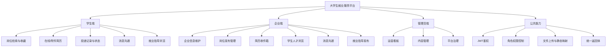

# 基于 Spring Boot 的大学生就业服务平台设计与实现

## 封面信息（模板）

- 题目：基于 Spring Boot 的大学生就业服务平台设计与实现
- 学院：`请填写学院名称`
- 专业：`请填写专业名称`
- 班级：`请填写班级`
- 学生姓名：`请填写姓名`
- 学号：`请填写学号`
- 指导教师：`请填写导师姓名`
- 完成日期：`请填写日期`

> 说明：本节为 Markdown 版封面信息占位，导出 Word 后可按学校封面模板排版替换。

---

## 摘要

在高校毕业生规模持续增长和就业结构不断变化的背景下，大学生在求职过程中普遍存在岗位信息分散、匹配效率不高、简历管理不便、沟通链路冗长等问题；企业在校园招聘场景中也面临筛选效率低、沟通成本高、人才触达不精准等现实挑战。针对上述问题，本文面向高校就业服务场景，设计并实现了一套基于 Spring Boot 的大学生就业服务平台。系统采用前后端分离架构，后端基于 Spring Boot、MyBatis-Plus 与 MySQL 构建，前端采用 Vue3 与 TypeScript 实现交互界面，通过 JWT 完成身份认证与权限控制。

平台以“学生求职链路”和“企业招聘链路”双主线组织功能，覆盖用户登录注册、岗位发布与检索、在线/附件简历管理、简历投递与状态追踪、企业收件箱、学生人才浏览、站内消息沟通、就业指导内容管理等核心业务。系统在实现过程中通过统一返回体规范接口输出，通过拦截器实现鉴权与角色校验，通过静态资源映射实现附件与图片文件管理，并利用浏览记录实现基础岗位推荐能力。测试结果表明，平台主要业务流程运行稳定，能够满足毕业设计阶段的功能需求与教学应用场景。

本文最后对系统的不足进行了分析，并从实时通信、推荐算法优化、权限模型增强与性能提升等方向提出后续改进建议。研究与实现结果表明，该平台具有较好的可用性、可维护性与扩展潜力，可为高校就业信息化建设提供参考。

**关键词**：大学生就业；Spring Boot；前后端分离；招聘平台；MyBatis-Plus；JWT

## Abstract（英文）

With the increasing number of college graduates and the continuous changes in the employment market, students often encounter fragmented job information, low matching efficiency, inconvenient resume management, and inefficient communication with employers. Enterprises also face practical challenges in campus recruitment, including low screening efficiency and high communication costs. To address these issues, this paper designs and implements a university employment service platform based on Spring Boot.

The system adopts a front-end and back-end separated architecture. The backend is built with Spring Boot, MyBatis-Plus, and MySQL, while the frontend is developed using Vue3 and TypeScript. JWT is used for authentication and role-based access control. The platform supports key business functions such as user registration and login, job publishing and filtering, online/attachment resume management, application tracking, company inbox management, student talent browsing, messaging, and employment guidance content management.

Implementation practices include standardized API response structure, interceptor-based authentication, static resource mapping for file management, and browsing-history-based job recommendation. Test results show that the platform can stably support core business workflows and satisfy the requirements of an undergraduate graduation project. Finally, this paper discusses current limitations and proposes future improvements in real-time communication, recommendation optimization, permission enhancement, and performance tuning.

**Key Words**: University Employment; Spring Boot; Frontend-Backend Separation; Recruitment Platform; MyBatis-Plus; JWT

---

## 目录

- 第 1 章 绪论  
  - 1.1 研究背景  
  - 1.2 研究目的与意义  
  - 1.3 国内外相关研究现状  
  - 1.4 研究内容  
  - 1.5 论文组织结构  
- 第 2 章 关键技术与开发环境  
  - 2.1 Spring Boot 框架  
  - 2.2 MyBatis-Plus 持久层框架  
  - 2.3 Vue3 与 TypeScript  
  - 2.4 JWT 认证机制  
  - 2.5 MySQL 数据库  
  - 2.6 开发与运行环境  
- 第 3 章 系统需求分析  
  - 3.1 需求概述  
  - 3.2 功能性需求分析  
  - 3.3 非功能性需求分析  
  - 3.4 可行性分析  
- 第 4 章 系统总体设计  
  - 4.1 核心功能模块实现（按角色）  
  - 4.2 总体架构设计  
  - 4.3 系统功能模块划分  
  - 4.4 业务流程设计  
  - 4.5 数据库设计  
  - 4.6 安全与文件资源设计  
- 第 5 章 系统详细实现  
  - 5.1 用户认证与权限控制实现  
  - 5.2 岗位管理模块实现  
  - 5.3 简历管理模块实现  
  - 5.4 投递与收件箱模块实现  
  - 5.5 消息沟通模块实现  
  - 5.6 就业指导与内容管理实现  
  - 5.7 前端页面实现  
- 第 6 章 系统测试与结果分析  
  - 6.1 测试目标与方法  
  - 6.2 测试环境  
  - 6.3 测试用例设计与执行  
  - 6.4 测试结果分析  
- 第 7 章 总结与展望  
  - 7.1 研究总结  
  - 7.2 存在问题  
  - 7.3 后续展望  
- 附录 A 数据库核心表设计（摘要）  
- 附录 B 核心接口清单（摘要）  
- 附录 C 系统部署与运行说明  
- 附录 D 术语与缩略语  
- 附录 E 本人完成工作量说明  
- 参考文献  
- 致谢

---

## 第 1 章 绪论

### 1.1 研究背景

随着数字化招聘模式的发展，大学生获取就业信息的渠道明显增多，但多平台分散使用导致信息碎片化问题更加突出。一方面，学生需要在不同渠道之间反复切换，进行岗位筛选、简历维护和进度跟踪；另一方面，企业在校园招聘中希望快速发现匹配人才，却常受制于简历质量差异、沟通效率不足和流程协同不畅。高校就业服务工作也需要更高效的平台工具，以提高就业服务的精准性和可追踪性。

在此背景下，构建一个面向大学生就业场景、同时兼顾学生端与企业端业务闭环的就业服务平台具有明确的现实价值和工程意义。

### 1.2 研究目的与意义

本课题的研究目的在于设计并实现一个可落地运行的大学生就业服务平台，实现从岗位信息发布、学生求职、企业筛选到信息沟通的全流程支持。其主要意义体现在以下方面：

1. 对学生而言，提供统一入口管理岗位、简历、投递和消息，降低求职成本；
2. 对企业而言，提升校园招聘效率，增强人才触达和筛选能力；
3. 对平台管理者而言，便于发布就业指导内容，形成“岗位服务 + 指导服务”双轮驱动；
4. 对毕业设计而言，具备完整的软件工程闭环，体现需求分析、系统设计、开发实现与测试验证能力。

### 1.3 国内外相关研究现状

国外大型招聘平台在推荐算法、数据建模和用户体验方面较为成熟，但校园场景定制不足；国内招聘平台在业务规模和服务能力方面发展迅速，但多数产品以社会招聘为主，对“应届生就业指导、校招流程协同、角色权限精细化”支持不充分。高校自建系统通常在场景契合度方面有优势，但常受限于系统架构扩展性、功能完整性和运维能力。

因此，基于主流技术栈构建可扩展、可维护的大学生就业服务平台，仍具有较强研究和实践价值。

### 1.4 研究内容

围绕课题目标，本文主要完成以下工作：

1. 分析大学生就业服务场景的业务需求与角色权限模型；
2. 设计前后端分离架构、数据库结构与核心业务流程；
3. 基于 Spring Boot 与 Vue3 实现平台功能模块；
4. 完成功能测试并分析系统效果与不足；
5. 给出后续优化方向。

### 1.5 论文组织结构

本文共分为七章。第一章为绪论；第二章介绍系统开发相关技术；第三章进行需求分析；第四章给出系统总体设计；第五章阐述核心模块实现；第六章进行系统测试与结果分析；第七章总结全文并展望后续工作。

---

## 第 2 章 关键技术与开发环境

### 2.1 Spring Boot 框架

Spring Boot 是当前 Java Web 开发中应用广泛的快速开发框架，具备自动装配、内嵌服务器、约定优于配置等特性。本文系统后端基于 Spring Boot 3.3.5 构建 RESTful 接口，降低配置复杂度，提升开发效率和维护性。

### 2.2 MyBatis-Plus 持久层框架

MyBatis-Plus 在 MyBatis 基础上提供通用 CRUD、Lambda 条件构造器、分页插件等能力，能够显著减少样板代码。本系统的数据访问层采用 MyBatis-Plus 完成复杂查询、动态条件过滤和状态更新。

### 2.3 Vue3 与 TypeScript

前端采用 Vue3 组件化开发模式，结合 TypeScript 提升代码类型安全和可维护性。系统通过 Vue Router 组织页面路由，并结合鉴权信息实现前端角色访问控制。

### 2.4 JWT 认证机制

平台使用 JWT 作为登录态令牌，令牌负载中包含用户 ID、角色等关键信息。后端通过拦截器对 `/api/**` 接口统一鉴权，前端通过路由守卫进行页面级权限限制，从而形成双层安全控制。

### 2.5 MySQL 数据库

MySQL 用于存储平台核心业务数据，包含用户、学生、企业、岗位、简历、投递、消息、浏览历史、收藏与内容管理等实体。关系型数据库能够保证事务一致性和数据完整性，满足业务稳定性需求。

### 2.6 开发与运行环境

- 操作系统：Windows 10/11
- JDK：17
- 后端：Spring Boot 3.x
- 前端：Vue3 + Vite + TypeScript
- 数据库：MySQL 5.7/8.0
- 构建工具：Maven
- 开发工具：IntelliJ IDEA、Cursor/VS Code、Navicat

---

## 第 3 章 系统需求分析

### 3.1 需求概述

本平台主要服务三类用户：学生、企业、管理员。系统需支持从“岗位信息供给”到“简历投递反馈”的完整闭环，同时提供就业指导内容管理与消息沟通能力。

### 3.2 功能性需求分析

#### 3.2.1 学生端需求

1. 用户注册、登录与个人信息维护；
2. 岗位查询、分类筛选与详情查看；
3. 收藏岗位、记录浏览轨迹；
4. 在线简历编辑与附件简历上传管理；
5. 职位投递及投递状态查看；
6. 与企业进行站内消息沟通；
7. 浏览就业指导与资讯内容。

#### 3.2.2 企业端需求

1. 企业信息维护与展示；
2. 岗位发布、修改、下线与查询；
3. 简历收件箱查看投递信息；
4. 学生人才浏览与详情查看；
5. 与学生发起和维护消息会话；
6. 发布和管理企业就业指导文章。

#### 3.2.3 管理员端需求

1. 平台基础运营与可视化看板查看；
2. 就业指导与资讯内容管理；
3. 平台数据治理与权限控制。

### 3.3 非功能性需求分析

1. **安全性需求**：接口访问需鉴权，关键操作需进行角色校验；
2. **稳定性需求**：核心流程（登录、投递、简历上传）需稳定执行；
3. **可扩展性需求**：模块化设计，便于后续增加推荐与统计功能；
4. **可维护性需求**：代码结构清晰，分层合理，便于迭代；
5. **易用性需求**：页面流程符合用户使用习惯，反馈信息清晰。

### 3.4 可行性分析

#### 3.4.1 技术可行性

系统采用成熟的 Spring Boot + Vue3 + MySQL 组合，开发资料丰富、生态完善，技术实现风险较低。

#### 3.4.2 经济可行性

开发环境以开源工具和本地部署为主，成本可控，符合毕业设计项目要求。

#### 3.4.3 操作可行性

系统按角色组织功能导航，交互流程清晰，学习成本较低，具备良好可操作性。

---

## 第 4 章 系统总体设计

### 4.1 核心功能模块实现（按角色）

本节从**角色维度**归纳平台已实现的核心功能模块及其业务闭环，说明各角色在平台中的操作对象与系统落点；分层架构、数据库表结构及安全机制见本章后续小节，接口与关键类级别的实现细节详见第 5 章。

#### 4.1.1 学生端（STUDENT）

学生端围绕“找岗位—备简历—投简历—跟进度—沟通”展开，主要功能模块如下。

1. **账号与档案维护**：基于 `sys_user` 完成登录注册（注册时联动写入 `student` 档案）；可维护姓名、联系方式、院校专业、头像等，供投递与对外展示使用。  
2. **岗位发现与意向管理**：浏览、检索、筛选岗位（关联 `job`、`category`）；支持岗位收藏（`favorite`）与浏览历史（`browsing_history`），并可作为同类岗位推荐的数据依据。  
3. **简历管理**：支持在线简历（结构化内容存于 `resume.content`，一般为 JSON）与附件简历（`resume.file_url`）；通过 `resume.type`、`is_public` 区分形态与可见性，投递时指定 `resume_id`。  
4. **投递与进度跟踪**：向目标岗位发起投递，写入 `application`；`(job_id, student_id)` 唯一约束保证同一岗位不重复投递；企业更新状态后学生可查看待查看、面试邀请、不合适、已录用等阶段。  
5. **消息与资讯**：通过站内消息（`message`，收发双方为 `sys_user.id`）与企业或管理员沟通；阅读平台就业指导（`guide`）与新闻公告（`news`）。

#### 4.1.2 企业端（COMPANY）

企业端围绕“亮品牌—发岗位—收简历—筛人才—沟通”展开，主要功能模块如下。

1. **企业与账号绑定**：企业用户注册后写入 `company`，与 `sys_user` 一对一关联；维护简介、Logo、地址、行业规模、联系方式及审核状态等，支撑学生对雇主信息的信任与筛选。  
2. **岗位发布与运营**：在 `job` 中创建、编辑、上下架岗位，配置分类、描述、任职要求、薪资区间与工作地点等；招聘中/已下架由 `status` 控制前台可见性。  
3. **简历收件与流程管理**：查看某岗位的投递列表（`application`），可结合 `resume` 查看在线内容或下载附件路径；更新投递状态以推进招聘漏斗。  
4. **人才发现**：可浏览学生侧公开档案与简历策略允许范围内的信息，辅助主动物色候选人（与简历公开设置、业务接口权限相匹配）。  
5. **沟通与内容**：使用消息模块与学生联络（面试通知等可由 `message.type` 区分语义）；可选发布就业指导类文章（`guide.user_id` 指向发布者用户）。

#### 4.1.3 管理员端（ADMIN）

管理员端侧重“看态势—配内容—管秩序”，主要功能模块如下。

1. **运营看板**：汇总用户与业务规模类指标（如学生/企业用户数、在招岗位数、投递量、简历量、消息量及内容阅读情况等），为就业服务运营提供可视化抓手。  
2. **新闻公告管理**：维护 `news`（标题、正文、发布人、浏览量等），用于政策宣讲、招聘会、系统通知与就业活动信息发布。  
3. **就业指导内容管理**：维护平台级指导文章（`guide` 中 `user_id` 可为空表示平台发布），与企业发布的指导内容共同构成就业指导体系。  
4. **权限边界**：管理员接口通过 JWT 中的 `role=ADMIN` 与拦截器校验控制访问，防止越权操作企业与学生的私有数据。

#### 4.1.4 平台公共能力（跨角色）

以下能力被多角色复用，不构成单一登录身份，但属于“核心功能模块”的支撑部分。

1. **统一认证与授权**：登录颁发 JWT，请求头携带 Token；后端解析后注入用户标识与角色，驱动接口级权限判断。  
2. **分类字典服务**：`category` 统一维护职位分类、行业分类等树形数据，供岗位筛选、企业行业展示与推荐逻辑使用。  
3. **文件与静态资源**：头像、企业 Logo、简历附件、指导封面等统一上传并映射访问路径，保证富文本与简历展示链路可用。

### 4.2 总体架构设计

系统采用前后端分离架构，划分为表示层、业务层、数据访问层和数据存储层：

1. **表示层**：Vue3 前端页面、组件与路由；
2. **业务层**：Spring Boot Controller 与 Service 处理业务逻辑；
3. **数据访问层**：Mapper 结合 MyBatis-Plus 执行数据库操作；
4. **存储层**：MySQL + 本地文件目录（头像、Logo、简历、封面）。

### 4.3 系统功能模块划分

1. 用户认证与权限模块；
2. 岗位管理与检索模块；
3. 简历管理模块；
4. 投递管理模块；
5. 消息沟通模块；
6. 就业指导内容模块；
7. 运营与管理模块。

### 4.3.1 系统功能结构图

### 4.4 业务流程设计

#### 4.4.1 学生求职流程

学生登录后浏览岗位并查看详情，选择目标岗位后可使用在线或附件简历进行投递；投递后可在个人中心查看状态变化，并可通过消息模块与企业沟通。

#### 4.4.2 企业招聘流程

企业登录后发布岗位并管理招聘信息；通过收件箱查看投递简历和候选人信息，筛选后更新投递状态，并通过消息模块与学生建立联系。

### 4.5 数据库设计

#### 4.5.1 概念模型

系统核心实体包括用户、学生、企业、岗位、简历、投递记录、消息、收藏、浏览历史与指导文章等。

#### 4.5.2 逻辑结构

主要业务表包括：`sys_user`、`student`、`company`、`job`、`resume`、`application`、`message`、`favorite`、`browsing_history`、`guide`、`category`。

其中，`application` 表设置 `(job_id, student_id)` 唯一约束，保证同一学生对同一岗位不可重复投递。

### 4.6 安全与文件资源设计

1. 采用 JWT + 拦截器实现接口鉴权；
2. 采用角色字段进行权限控制（STUDENT、COMPANY、ADMIN）；
3. 采用统一文件存储路径和 URL 映射管理上传资源；
4. 采用统一响应结构封装结果与错误信息。

---

## 第 5 章 系统详细实现

### 5.1 用户认证与权限控制实现

用户登录成功后，系统生成包含用户标识和角色信息的 JWT。前端将 Token 持久化并在请求头中携带，后端拦截器解析 Token 后将用户信息注入请求上下文，业务接口据此进行权限判断。

系统在前端路由层实现角色守卫机制：未登录用户访问受限页面将被重定向至登录页；角色不匹配的用户将跳转到其默认首页。该机制提升了系统交互一致性与安全性。

### 5.2 岗位管理模块实现

岗位模块支持以下核心能力：

1. 最新岗位展示；
2. 热门岗位展示；
3. 按关键词、分类筛选岗位；
4. 企业发布岗位与查看本企业岗位列表；
5. 岗位详情查看与状态校验。

此外，系统基于学生浏览历史提取偏好类别，返回同类别且未浏览岗位，实现基础推荐功能。

### 5.3 简历管理模块实现

系统支持在线简历与附件简历并行管理：

1. **在线简历**：用于快速编辑和结构化展示，支持按学生维度更新；
2. **附件简历**：支持 PDF 上传并保存访问 URL，支持同名简历覆盖提示；
3. **简历详情聚合**：企业查看简历时同时展示学生基础信息与简历主体。

通过静态资源映射配置，平台可直接访问已上传文件，满足企业端下载与预览需求。

### 5.4 投递与收件箱模块实现

学生提交投递后，系统写入投递记录并设置初始状态。由于数据库层设置了唯一约束，系统可有效阻止重复投递。企业端收件箱模块聚合投递记录、岗位信息、学生信息和简历信息，形成结构化视图，便于筛选和处理。

投递状态包含“待查看、已查看、面试邀请、不合适、已录用”等类型，覆盖常见招聘流程。

### 5.5 消息沟通模块实现

消息模块支持企业与学生双向通信，包含：

1. 会话列表查询（按最近消息聚合）；
2. 指定对象聊天记录查询（按时间升序）；
3. 消息发送与已读状态更新。

该模块增强了平台的互动性，缩短了求职沟通路径。

### 5.6 就业指导与内容管理实现

就业指导模块区分企业发布与管理员发布两类内容：

1. 企业可管理本人发布文章；
2. 管理员可进行平台级内容发布、编辑和删除；
3. 普通用户可浏览列表与详情，详情访问可累加浏览量。

该模块使平台从“信息撮合工具”扩展为“就业服务平台”。

### 5.7 前端页面实现

前端根据角色组织页面入口与导航：

1. 学生端：岗位浏览、简历管理、投递记录、消息中心、就业指导；
2. 企业端：企业主页、岗位管理、收件箱、人才浏览、消息中心、指导发布；
3. 管理端：运营看板、新闻与指导管理。

页面实现采用组件化方式，提升复用性和可维护性。

---

## 第 6 章 系统测试与结果分析

### 6.1 测试目标与方法

测试目标是验证系统核心业务流程完整性、角色权限正确性与主要接口可用性。测试方法以功能测试为主，辅以接口联调验证。

### 6.2 测试环境

- 操作系统：Windows 10/11
- 浏览器：Chrome/Edge
- 后端：Spring Boot 3.x
- 前端：Vue3 + Vite
- 数据库：MySQL
- 测试方式：页面功能测试 + 接口返回校验

### 6.3 典型测试用例
### 6.3 测试用例设计与执行

| 用例编号 | 测试模块 | 测试内容 | 预期结果 | 实际结果 |
| --- | --- | --- | --- | --- |
| TC-01 | 登录认证 | 正确账号密码登录 | 返回 Token，跳转角色首页 | 通过 |
| TC-02 | 登录认证 | 未登录访问受限接口 | 返回未授权错误 | 通过 |
| TC-03 | 权限控制 | 学生调用企业发布岗位接口 | 返回权限错误 | 通过 |
| TC-04 | 岗位管理 | 企业发布岗位并查询列表 | 新岗位可见，字段正确 | 通过 |
| TC-05 | 简历管理 | 学生上传附件简历 | 返回可访问 fileUrl | 通过 |
| TC-06 | 简历管理 | 在线简历新增/更新 | 数据正确保存并可回显 | 通过 |
| TC-07 | 投递管理 | 同一岗位重复投递 | 第二次投递被拦截 | 通过 |
| TC-08 | 收件箱 | 企业查看投递收件箱 | 可查看岗位+学生+简历信息 | 通过 |
| TC-09 | 消息沟通 | 学生与企业互发消息 | 会话列表与聊天记录正确 | 通过 |
| TC-10 | 内容管理 | 企业编辑他人文章 | 返回无权操作提示 | 通过 |

### 6.3.1 测试结果统计

- 用例总数：10
- 通过数：10
- 失败数：0
- 通过率：100%

### 6.4 测试结果分析

测试结果表明，系统在登录鉴权、岗位管理、简历投递、消息交互和内容管理等核心流程上运行稳定，角色权限边界基本正确，能够满足毕业设计阶段的功能目标。当前系统在高并发场景、实时消息能力和智能推荐精度方面仍有提升空间。

---

## 第 7 章 总结与展望

### 7.1 研究总结

本文完成了基于 Spring Boot 的大学生就业服务平台的需求分析、架构设计、模块实现和测试验证。系统围绕学生与企业的核心业务场景构建功能闭环，实现了多角色协同、权限控制、简历投递与沟通管理，并在实际运行中表现出较好的稳定性和可用性。通过本项目的实施，验证了前后端分离架构在高校就业服务系统中的可行性与工程价值。

### 7.2 存在问题

1. 推荐逻辑仍以规则匹配为主，个性化程度有限；
2. 消息模块仍为普通接口交互，实时性有待提升；
3. 权限控制可进一步细化到资源级别；
4. 系统性能优化和监控告警机制尚不完善。

### 7.3 后续展望

1. 引入协同过滤或画像模型提升岗位推荐效果；
2. 基于 WebSocket 构建实时消息能力；
3. 引入缓存与异步机制优化高频接口性能；
4. 完善日志审计、异常监控与运维体系；
5. 探索与高校教务或就业系统的数据联动。

---

## 附录 A 数据库核心表设计（摘要）

### A.1 `sys_user`（系统用户表）

- 主键：`id`
- 关键字段：`username`、`password`、`role`
- 说明：存储登录账号与角色（学生/企业/管理员）

### A.2 `student`（学生信息表）

- 主键：`id`
- 外键关联：`user_id -> sys_user.id`
- 关键字段：`name`、`gender`、`phone`、`email`、`university`、`major`

### A.3 `company`（企业信息表）

- 主键：`id`
- 外键关联：`user_id -> sys_user.id`
- 关键字段：`name`、`industry`、`scale`、`contact_person`、`contact_phone`

### A.4 `job`（岗位信息表）

- 主键：`id`
- 外键关联：`company_id -> company.id`
- 关键字段：`title`、`category_id`、`salary_min`、`salary_max`、`location`、`status`

### A.5 `resume`（简历信息表）

- 主键：`id`
- 外键关联：`student_id -> student.id`
- 关键字段：`type`（1在线/2附件）、`title`、`content`、`file_url`、`is_public`

### A.6 `application`（投递记录表）

- 主键：`id`
- 外键关联：`job_id`、`student_id`、`resume_id`
- 关键字段：`status`、`create_time`
- 约束：`(job_id, student_id)` 唯一，防止重复投递

### A.7 其他辅助表

- `message`：站内消息
- `favorite`：岗位收藏
- `browsing_history`：浏览历史
- `guide`：就业指导
- `category`：分类字典

---

## 附录 B 核心接口清单（摘要）

### B.1 认证与用户

- `POST /auth/login`：用户登录
- `POST /auth/register`：用户注册
- `GET /api/user/me`：获取当前用户信息

### B.2 学生侧接口

- `GET /api/student/profile`：获取学生资料
- `PUT /api/student/profile`：更新学生资料
- `GET /api/job/filter`：岗位筛选
- `POST /api/application/apply`：投递岗位
- `GET /api/application/student/{studentId}`：查看投递记录
- `POST /api/resume/online`：保存在线简历
- `POST /api/resume/upload`：上传附件简历

### B.3 企业侧接口

- `GET /api/company/profile`：获取企业资料
- `PUT /api/company/profile`：更新企业资料
- `POST /api/job/create`：发布岗位
- `GET /api/application/inbox`：查看简历收件箱
- `GET /api/student/company/browse`：人才浏览
- `POST /api/message/company/send`：发送企业消息

### B.4 内容管理接口

- `GET /api/guide/list`：就业指导列表
- `GET /api/guide/{id}`：就业指导详情
- `POST /api/guide/company`：企业发布指导
- `POST /api/guide/admin`：管理员发布指导

---

## 附录 C 系统部署与运行说明

### C.1 后端运行步骤

1. 创建数据库 `employment_platform`；
2. 导入 `employment_platform.sql` 初始化表结构和测试数据；
3. 修改 `springboot/src/main/resources/application.yml` 中数据库连接配置；
4. 在 `springboot` 目录执行 Maven 构建并启动应用；
5. 默认后端端口为 `9999`。

### C.2 前端运行步骤

1. 进入 `vue/vue-project` 目录；
2. 安装依赖（`npm install`）；
3. 启动开发服务（`npm run dev`）；
4. 浏览器访问前端地址进行联调。

### C.3 注意事项

- 确保后端静态文件目录具备读写权限（头像、Logo、简历、指导封面）；
- 前后端接口地址保持一致；
- 若使用生产环境部署，建议配置 HTTPS、反向代理与日志监控。

---

## 附录 D 术语与缩略语

| 缩写 | 英文全称 | 中文说明 |
| --- | --- | --- |
| JWT | JSON Web Token | 基于 Token 的用户身份认证机制 |
| RBAC | Role-Based Access Control | 基于角色的访问控制模型 |
| API | Application Programming Interface | 应用程序接口 |
| CRUD | Create Read Update Delete | 增删改查基础数据操作 |
| ORM | Object Relational Mapping | 对象关系映射思想 |
| UI | User Interface | 用户界面 |
| UX | User Experience | 用户体验 |
| SQL | Structured Query Language | 结构化查询语言 |
| VO | View Object | 视图层数据传输对象 |
| MVC | Model View Controller | 模型-视图-控制器架构模式 |

---

## 附录 E 本人完成工作量说明

### E.1 需求与设计工作

1. 完成课题调研、需求分析与角色权限模型梳理；
2. 完成系统总体架构设计、功能模块划分与数据库逻辑设计；
3. 绘制业务流程并形成论文文档结构。

### E.2 后端开发工作

1. 完成基于 Spring Boot 的后端项目搭建与接口分层设计；
2. 实现用户认证、JWT 鉴权、角色权限控制；
3. 实现岗位管理、简历管理、投递管理、消息沟通、就业指导等核心业务接口；
4. 完成文件上传与静态资源映射配置；
5. 完成主要业务流程联调与问题修复。

### E.3 前端开发工作

1. 完成 Vue3 前端页面开发与路由组织；
2. 实现学生端、企业端、管理员端主要页面与交互逻辑；
3. 实现登录态管理与前端路由守卫；
4. 完成接口联调、页面优化与用户流程打通。

### E.4 测试与文档工作

1. 编写并执行核心功能测试用例；
2. 记录测试结果并进行问题定位与修正；
3. 完成毕业论文撰写、图表整理与附录编制。

### E.5 工作量总结

本课题实现了从需求分析、系统设计、编码实现、联调测试到论文撰写的完整流程，整体工作量覆盖软件工程毕业设计的主要实践环节。

---

## 参考文献

[1] Walls C. Spring Boot 实战[M]. 北京: 人民邮电出版社, 2023.  
[2] 王珊, 萨师煊. 数据库系统概论[M]. 北京: 高等教育出版社, 2022.  
[3] 张海藩. 软件工程导论[M]. 6版. 北京: 清华大学出版社, 2013.  
[4] MyBatis-Plus 开发团队. MyBatis-Plus 官方文档[EB/OL]. [https://baomidou.com](https://baomidou.com), 2026-03-27.  
[5] Vue.js Team. Vue.js 官方文档[EB/OL]. [https://cn.vuejs.org](https://cn.vuejs.org), 2026-03-27.  
[6] Jones M, Bradley J, Sakimura N. JSON Web Token (JWT)[S/OL]. RFC 7519. [https://www.rfc-editor.org/rfc/rfc7519](https://www.rfc-editor.org/rfc/rfc7519), 2015.  
[7] Pressman R S, Maxim B R. Software Engineering: A Practitioner's Approach[M]. 9th ed. New York: McGraw-Hill, 2019.  
[8] Sommerville I. Software Engineering[M]. 10th ed. Boston: Pearson, 2020.

---

## 致谢

本课题在导师的悉心指导下顺利完成。导师在选题确定、系统设计、论文撰写等方面给予了细致建议和持续支持。感谢同学在系统测试与使用反馈中提供的帮助，感谢开源社区提供的技术文档与开发框架支持。通过本次毕业设计，我在需求分析、系统建模、工程实现与问题排查方面都获得了系统提升。

