# 数据库实体属性图（Chen 风格 · Mermaid）

> 参考传统 **Chen 表示法**：下方矩形为**实体**，上方**椭圆**为属性，**主键属性名称加下划线**（使用 HTML `<u>`；若编辑器不渲染，可改为手写「id（主键）」）。  
> Mermaid 用 `([ ])` 近似椭圆（胶囊形）；实体用 `[ ]` 矩形。  
> 连线为无向 `---`，表示属性属于该实体。

---

## 使用说明

- 导出图片时若 **下划线不显示**：把 `<u>id</u>` 改成 `id（主键）` 即可。
- 若 **椭圆不够圆**：可在 draw.io / Visio 中照此结构重画，或接受 Mermaid 默认胶囊形。

---

## 1. 系统用户 `sys_user` — 实体「系统用户」

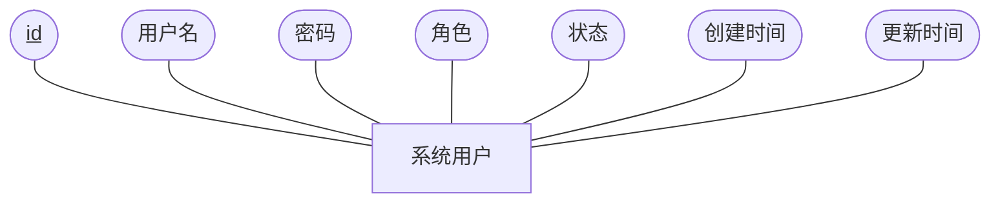

---

## 2. 学生 `student` — 实体「学生」

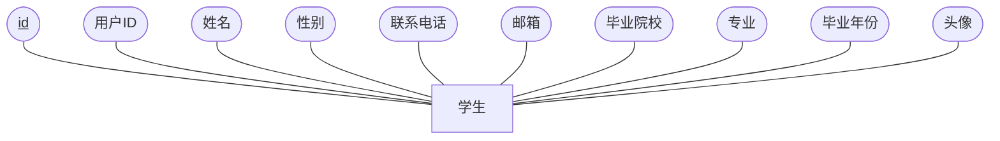

---

## 3. 企业 `company` — 实体「企业」

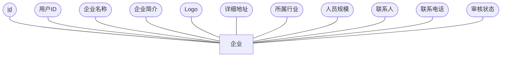

---

## 4. 分类 `category` — 实体「分类」

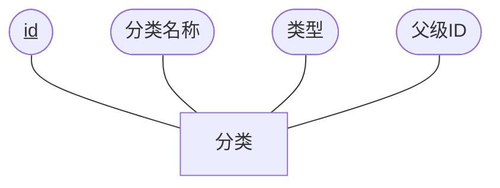

---

## 5. 职位 `job` — 实体「职位」

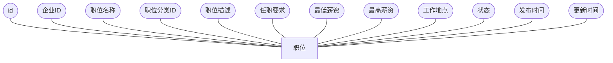

---

## 6. 简历 `resume` — 实体「简历」

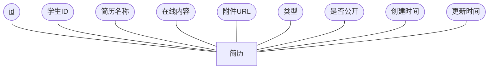

---

## 7. 职位申请 `application` — 实体「职位申请」

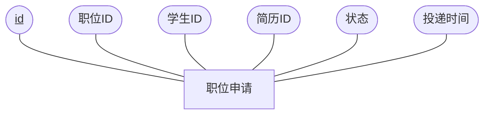

---

## 8. 职位收藏 `favorite` — 实体「职位收藏」

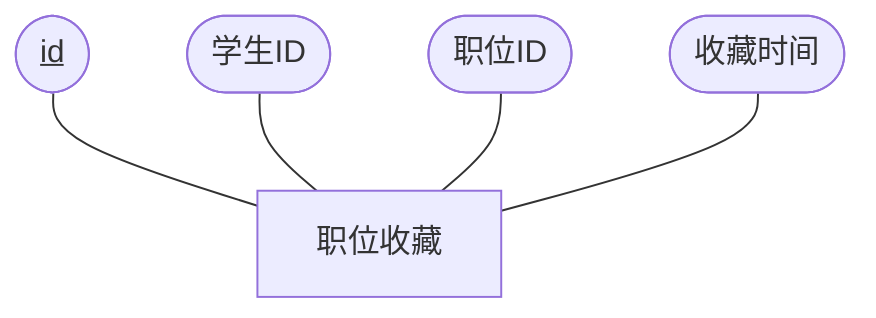

---

## 9. 浏览历史 `browsing_history` — 实体「浏览历史」

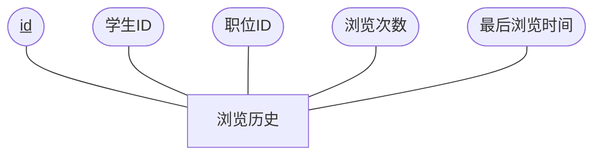

---

## 10. 站内消息 `message` — 实体「站内消息」

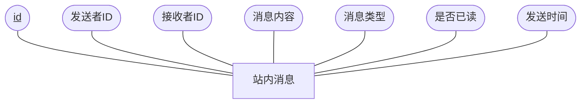

---

## 11. 就业指导 `guide` — 实体「就业指导」

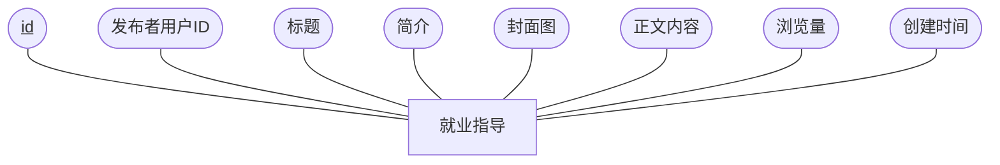

---

## 12. 新闻公告 `news` — 实体「新闻公告」

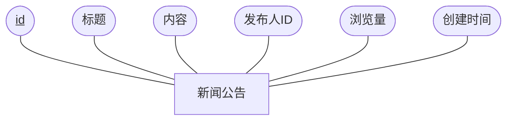

---

## 仅「管理员」视角的示意（与你截图一致的结构）

若论文需要单独强调管理员账号字段，可用下面示意（对应 `sys_user` 中 `ADMIN` 角色，属性与表一致）：

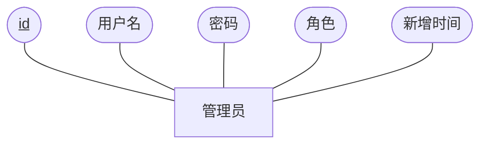

> 说明：库中无单独「管理员表」，管理员与普通用户同属 `sys_user`，通过「角色」区分；正式论文建议以 **系统用户实体** 为准，本图为风格对齐用。
