# 数据库各表实体属性图（Mermaid）

> 依据 `employment_platform.sql` 中表结构整理。每张表单独一个图，便于论文中「图 X-X 某某表实体属性图」逐张导出。  
> 说明：`PK` 主键，`FK` 外键逻辑关联，`UK` 唯一约束（多字段 UK 在图下文字说明）。

---

## 1. `sys_user` 系统用户表

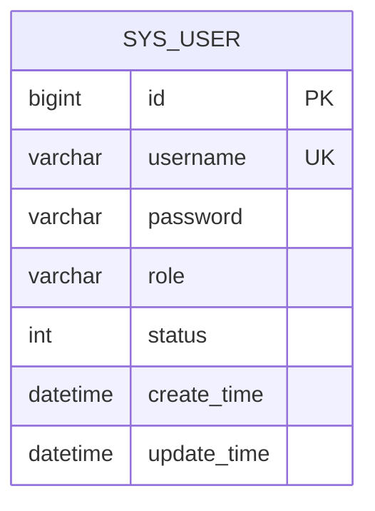

- 唯一约束：`uk_username(username)`

---

## 2. `student` 学生表

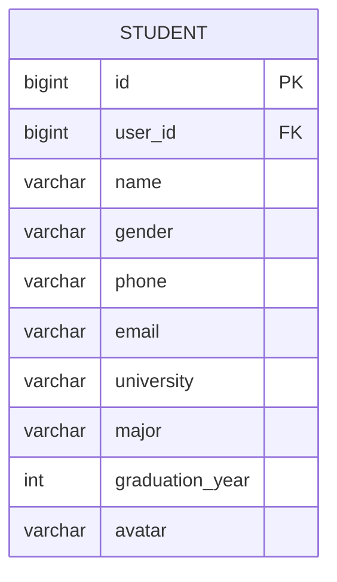

- 唯一约束：`uk_user_id(user_id)` → 关联 `sys_user.id`

---

## 3. `company` 企业表

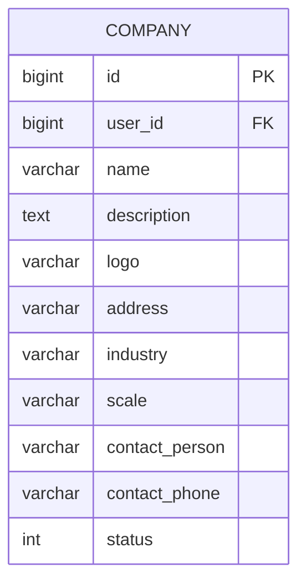

- 唯一约束：`uk_user_id(user_id)` → 关联 `sys_user.id`

---

## 4. `category` 分类字典表

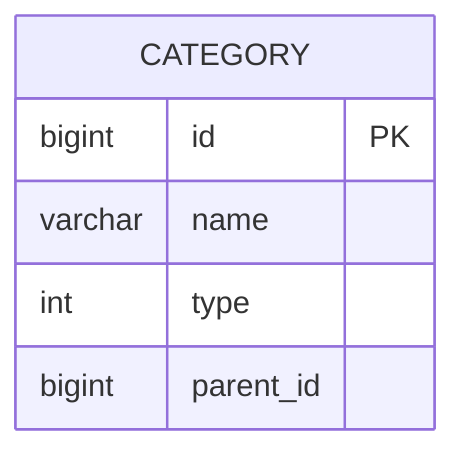

- `type`：1 职位分类，2 行业分类；`parent_id` 父级，0 表示根。

---

## 5. `job` 职位表

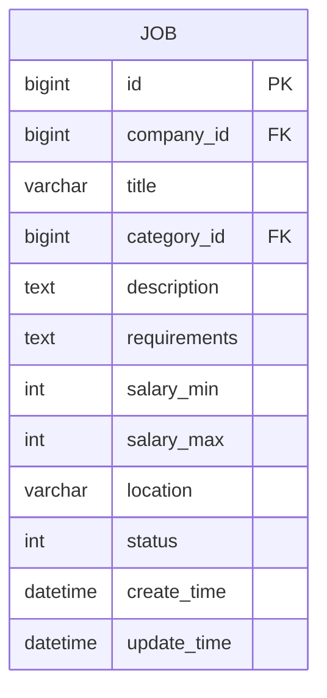

- `company_id` → `company.id`；`category_id` → `category.id`（可空）。

---

## 6. `resume` 简历表

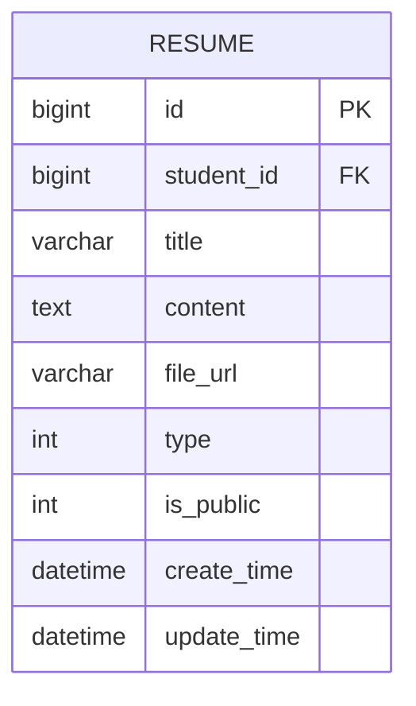

- `student_id` → `student.id`；`type`：1 在线简历，2 附件简历；索引 `idx_student_id(student_id)`。

---

## 7. `application` 职位申请表

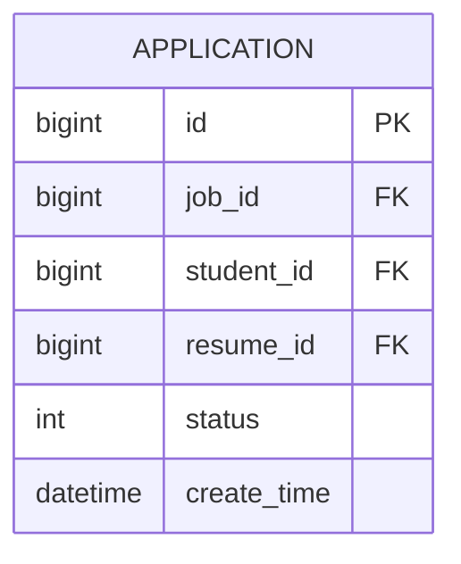

- 唯一约束：`uk_job_student(job_id, student_id)`（同一职位同一学生仅一条投递）。

---

## 8. `favorite` 职位收藏表

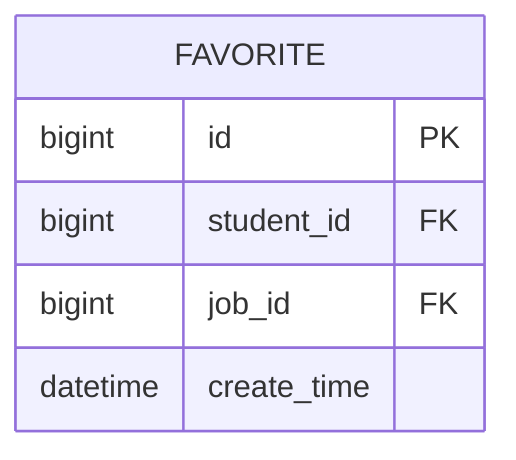

- 唯一约束：`uk_student_job(student_id, job_id)`。

---

## 9. `browsing_history` 浏览历史表

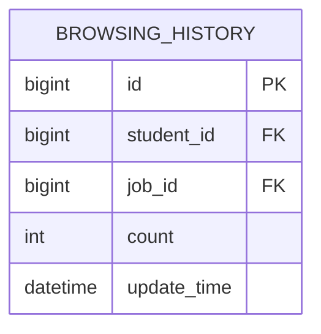

- 唯一约束：`uk_student_job(student_id, job_id)`。

---

## 10. `message` 站内消息表

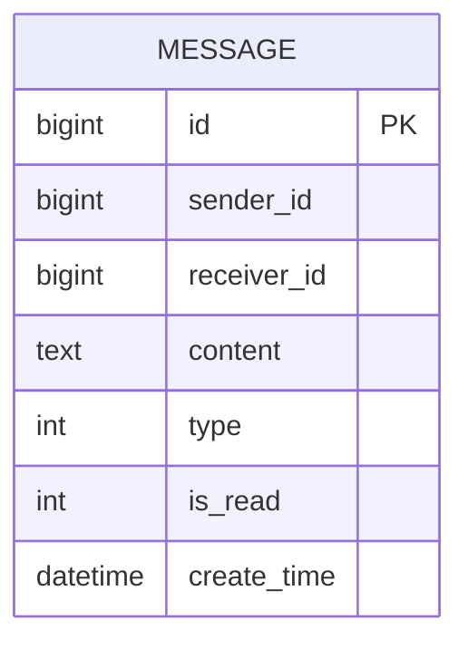

- 字段注释为发送者/接收者 ID；业务上可与学生或企业实体 ID 对应（多态，非单一外键）。索引 `idx_receiver(receiver_id)`。

---

## 11. `guide` 就业指导表

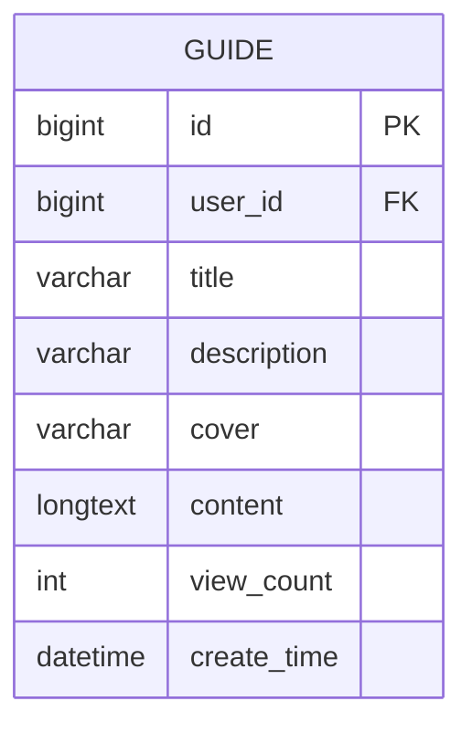

- `user_id` 可空：企业发文为 `sys_user.id`，平台发文可为 `NULL`。

---

## 12. `news` 新闻公告表

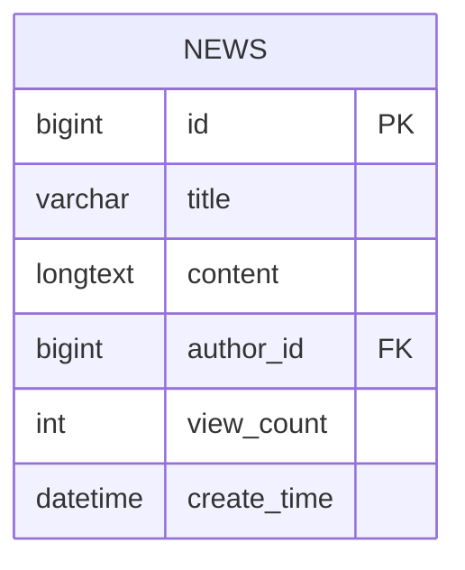

- `author_id` → 发布人，通常对应 `sys_user.id`（可空）。

---

## 附：若渲染器报错

部分 Mermaid 版本对 `longtext` 等类型名敏感，可将 `longtext` 改为 `text`，或将中文注释改为纯英文字段说明后再导出。
