# 大学生就业服务平台 Mermaid 图集

> 说明：以下图均可直接复制到支持 Mermaid 的编辑器中导出图片。  
> 若你的渲染器不支持 `erDiagram` 的中文字段名，可把中文改为英文后再渲染。

---

## 1. 系统功能结构图

```mermaid
graph TD
    A[大学生就业服务平台]

    A --> B[学生端]
    A --> C[企业端]
    A --> D[管理员端]
    A --> E[平台公共能力]

    B --> B1[注册登录]
    B --> B2[岗位浏览与筛选]
    B --> B3[岗位收藏与浏览记录]
    B --> B4[在线简历管理]
    B --> B5[附件简历上传]
    B --> B6[职位投递与状态跟踪]
    B --> B7[消息沟通]
    B --> B8[就业指导浏览]

    C --> C1[企业资料维护]
    C --> C2[岗位发布与管理]
    C --> C3[简历收件箱]
    C --> C4[学生人才浏览]
    C --> C5[投递状态处理]
    C --> C6[消息沟通]
    C --> C7[就业指导发布管理]

    D --> D1[管理员登录]
    D --> D2[运营看板]
    D --> D3[新闻管理]
    D --> D4[就业指导管理]

    E --> E1[JWT鉴权]
    E --> E2[角色权限控制]
    E --> E3[文件上传与静态资源映射]
    E --> E4[统一返回体]
```

---

## 1.1 系统总体架构图

> 前后端分离 + 典型三层（接口 / 业务 / 持久）+ 数据与文件存储，适合论文「系统总体设计 / 架构设计」小节。

### 1.1.1 分层总体架构（推荐）

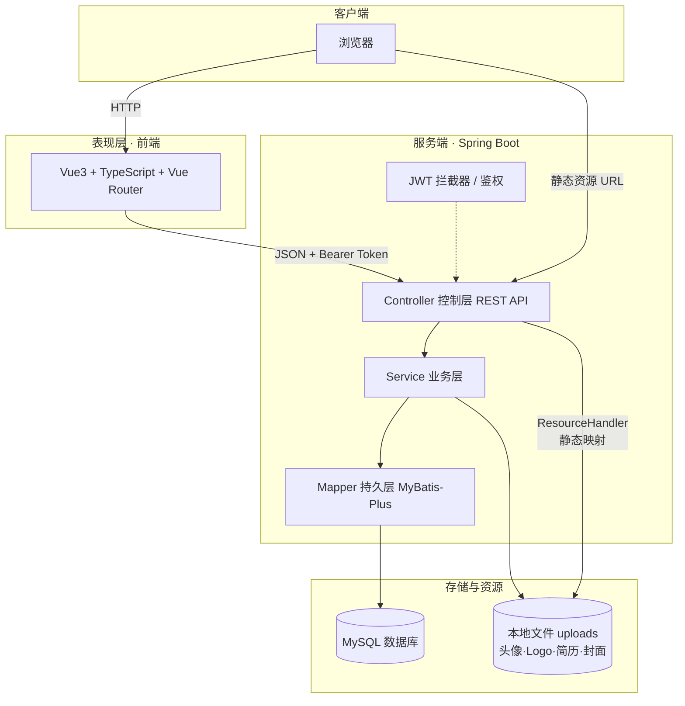

### 1.1.2 简化总体架构（版面紧凑）

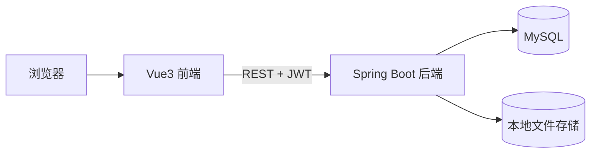

### 1.1.3 请求交互示意（可选）

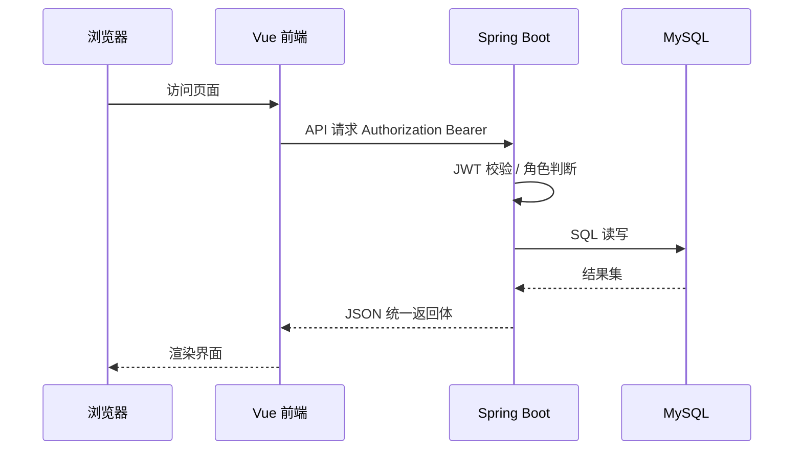

---

## 2. 系统整体用例图

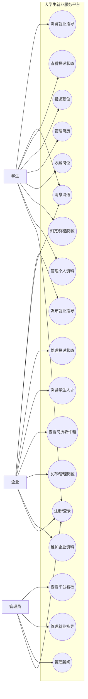

---

## 2.1 学生角色用例图

> 仅展示学生（STUDENT）与系统之间的用例关系，适合论文「学生端用例分析」小节。

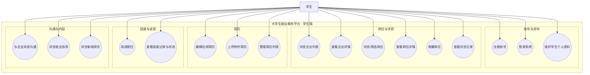

### 2.1.1 学生用例图（扁平版 · 导出更紧凑）

若渲染器对子图支持不好，可用下面扁平版：

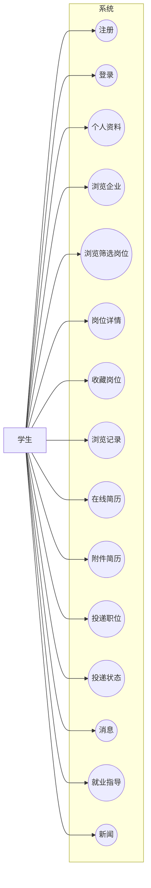

---

## 2.2 企业角色用例图

> 仅展示企业（COMPANY）与系统之间的用例关系，适合论文「企业端用例分析」小节。

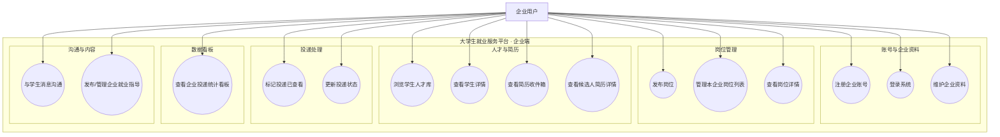

### 2.2.1 企业用例图（扁平版 · 导出更紧凑）

若渲染器对子图支持不好，可用下面扁平版：

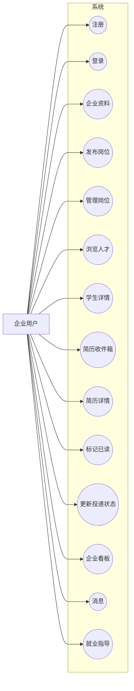

---

## 2.3 管理员角色用例图

> 仅展示管理员（ADMIN）与系统之间的用例关系，适合论文「管理端用例分析」小节。

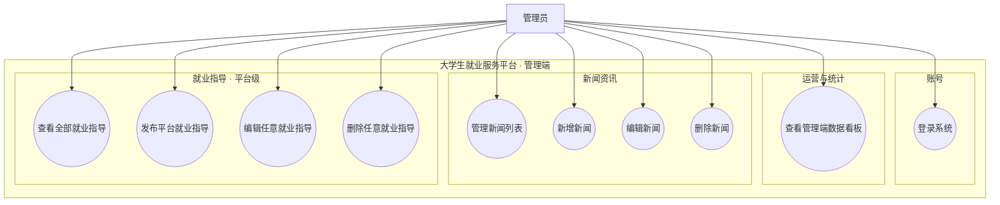

### 2.3.1 管理员用例图（扁平版 · 导出更紧凑）

若渲染器对子图支持不好，可用下面扁平版：

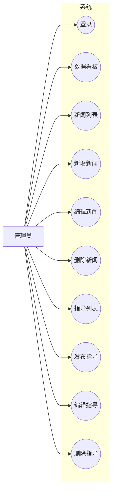

---

## 3. 各核心功能流程图

### 3.1 用户注册/登录流程

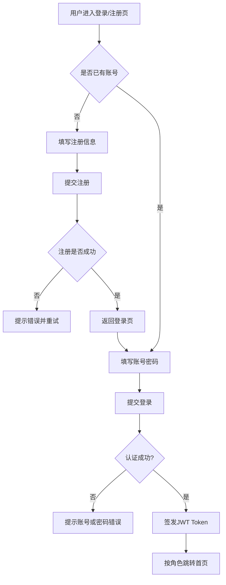

### 3.2 学生岗位浏览与筛选流程

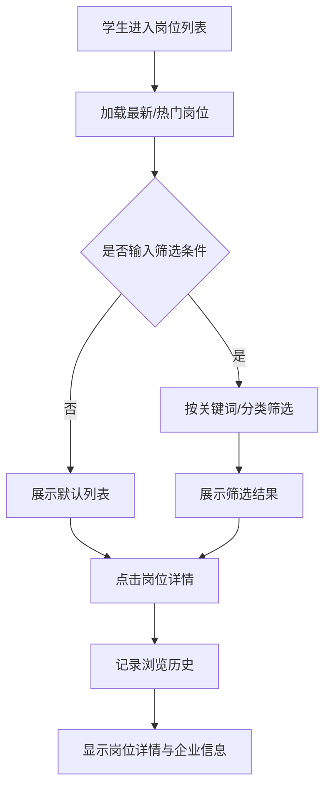

### 3.3 简历管理流程（在线 + 附件）

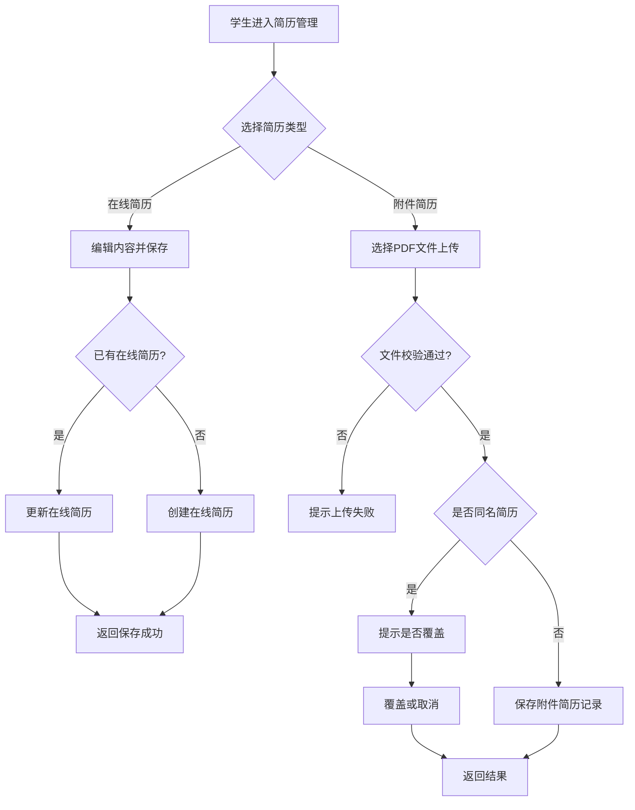

### 3.4 职位投递流程

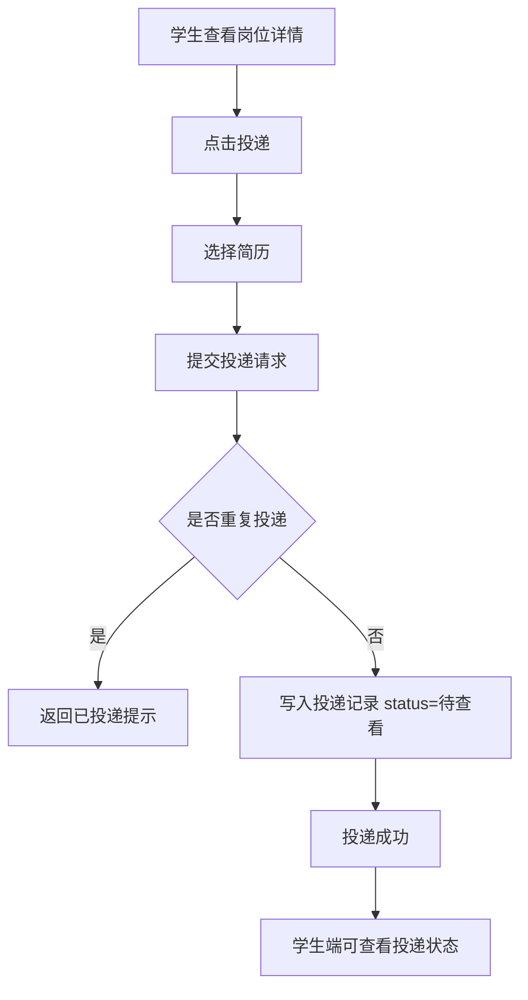

### 3.5 企业收件箱处理流程

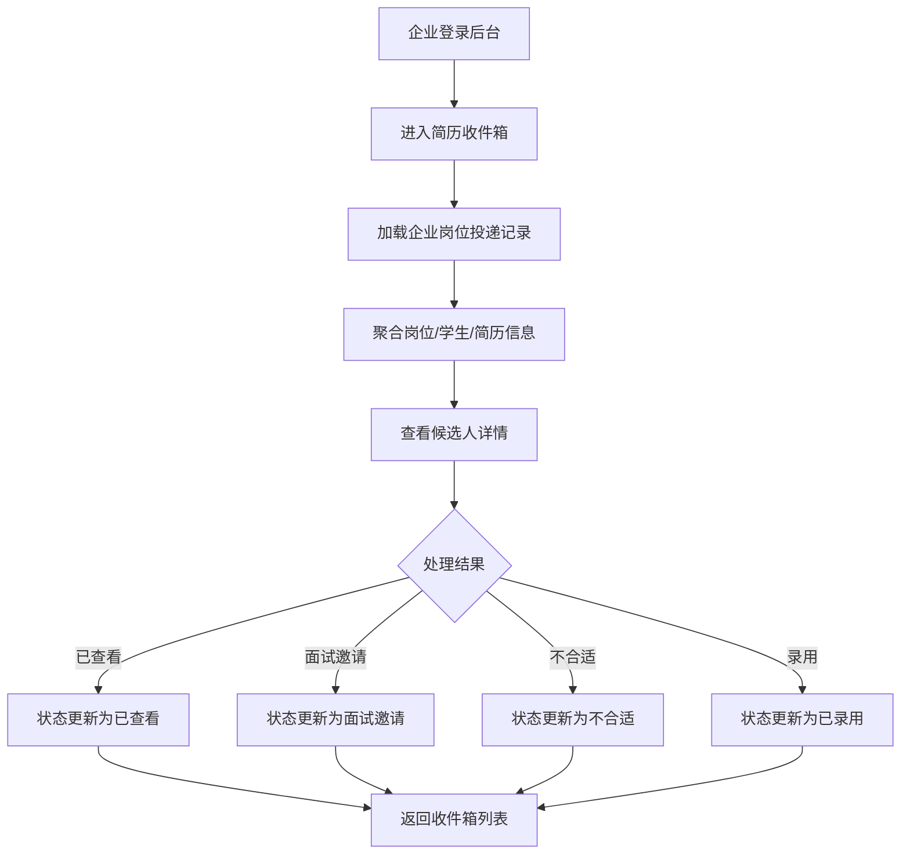

### 3.6 消息沟通流程（学生-企业）

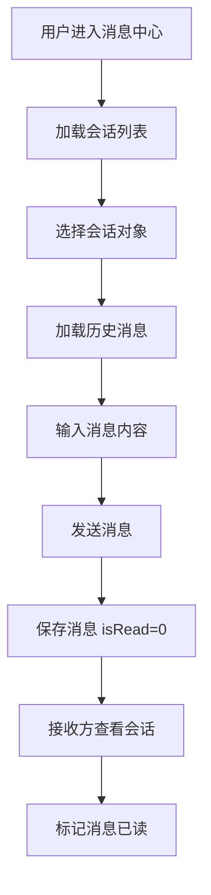

### 3.7 就业指导内容流程（企业/管理员）

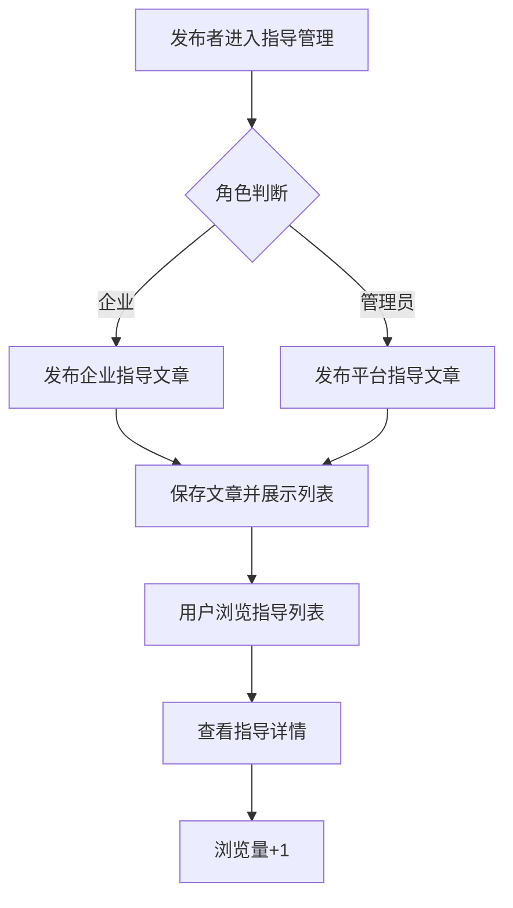

### 3.8 管理员内容管理流程

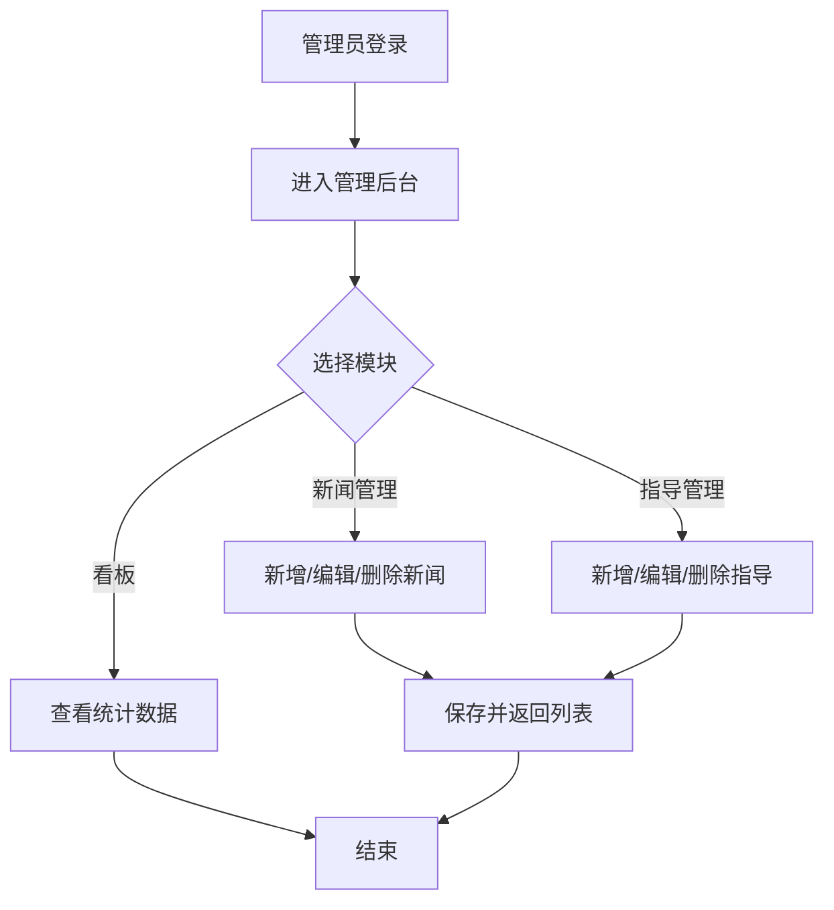

---

## 4.0 系统 ER 图（全库实体关系 · 推荐导出）

> 覆盖 `employment_platform` 库中主要业务表及关联。`message.sender_id` / `receiver_id` 在脚本中均为 **`sys_user.id`**（学生/企业/管理员账号均可作为收发方），与 `student`/`company` 表无直接外键。

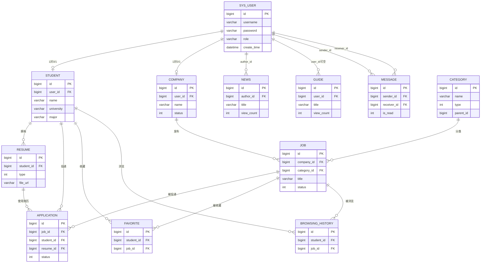

### 4.0.1 系统 ER 图（仅关系线 · 字段最少 · 大图友好）

```mermaid
erDiagram
    SYS_USER ||--o| STUDENT : maps
    SYS_USER ||--o| COMPANY : maps
    SYS_USER ||--o{ NEWS : writes
    SYS_USER ||--o{ GUIDE : writes
    SYS_USER ||--o{ MESSAGE : sends
    SYS_USER ||--o{ MESSAGE : receives

    COMPANY ||--o{ JOB : publishes
    CATEGORY ||--o{ JOB : classifies

    STUDENT ||--o{ RESUME : owns
    STUDENT ||--o{ APPLICATION : submits
    JOB ||--o{ APPLICATION : receives
    RESUME ||--o{ APPLICATION : used_by

    STUDENT ||--o{ FAVORITE : saves
    JOB ||--o{ FAVORITE : bookmarked

    STUDENT ||--o{ BROWSING_HISTORY : tracks
    JOB ||--o{ BROWSING_HISTORY : viewed
```

---

## 4. 数据库 ER 图（核心业务表）

```mermaid
erDiagram
    SYS_USER ||--o| STUDENT : "1对0/1"
    SYS_USER ||--o| COMPANY : "1对0/1"
    SYS_USER ||--o{ NEWS : "发布新闻"
    COMPANY ||--o{ JOB : "发布"
    STUDENT ||--o{ RESUME : "拥有"
    STUDENT ||--o{ APPLICATION : "投递"
    JOB ||--o{ APPLICATION : "被投递"
    RESUME ||--o{ APPLICATION : "用于投递"
    STUDENT ||--o{ FAVORITE : "收藏"
    JOB ||--o{ FAVORITE : "被收藏"
    STUDENT ||--o{ BROWSING_HISTORY : "浏览"
    JOB ||--o{ BROWSING_HISTORY : "被浏览"
    SYS_USER ||--o{ MESSAGE : "sender_id"
    SYS_USER ||--o{ MESSAGE : "receiver_id"
    SYS_USER ||--o{ GUIDE : "发布(可空)"
    CATEGORY ||--o{ JOB : "岗位分类"

    SYS_USER {
        bigint id PK
        varchar username
        varchar password
        varchar role
        datetime create_time
    }
    STUDENT {
        bigint id PK
        bigint user_id FK
        varchar name
        varchar gender
        varchar phone
        varchar email
        varchar university
        varchar major
    }
    COMPANY {
        bigint id PK
        bigint user_id FK
        varchar name
        varchar industry
        varchar scale
        varchar contact_person
        varchar contact_phone
        int status
    }
    CATEGORY {
        bigint id PK
        varchar name
        int type
        bigint parent_id
    }
    JOB {
        bigint id PK
        bigint company_id FK
        bigint category_id FK
        varchar title
        varchar location
        decimal salary_min
        decimal salary_max
        int status
        datetime create_time
    }
    RESUME {
        bigint id PK
        bigint student_id FK
        int type
        varchar title
        text content
        varchar file_url
        int is_public
        datetime update_time
    }
    APPLICATION {
        bigint id PK
        bigint job_id FK
        bigint student_id FK
        bigint resume_id FK
        int status
        datetime create_time
    }
    FAVORITE {
        bigint id PK
        bigint student_id FK
        bigint job_id FK
        datetime create_time
    }
    BROWSING_HISTORY {
        bigint id PK
        bigint student_id FK
        bigint job_id FK
        int count
        datetime update_time
    }
    MESSAGE {
        bigint id PK
        bigint sender_id
        bigint receiver_id
        text content
        int is_read
        datetime create_time
    }
    GUIDE {
        bigint id PK
        bigint user_id FK
        varchar title
        text content
        int view_count
        datetime create_time
    }
    NEWS {
        bigint id PK
        varchar title
        longtext content
        bigint author_id FK
        int view_count
        datetime create_time
    }
```

---

## 5. 系统整体 ER 图（分域视角）

```mermaid
erDiagram
    %% 账号域
    SYS_USER ||--o| STUDENT : "映射"
    SYS_USER ||--o| COMPANY : "映射"

    %% 招聘域
    COMPANY ||--o{ JOB : "管理"
    CATEGORY ||--o{ JOB : "归类"
    STUDENT ||--o{ RESUME : "管理"
    STUDENT ||--o{ APPLICATION : "发起"
    JOB ||--o{ APPLICATION : "接收"
    RESUME ||--o{ APPLICATION : "关联"

    %% 行为域
    STUDENT ||--o{ FAVORITE : "收藏行为"
    JOB ||--o{ FAVORITE : "收藏对象"
    STUDENT ||--o{ BROWSING_HISTORY : "浏览行为"
    JOB ||--o{ BROWSING_HISTORY : "浏览对象"

    %% 沟通与内容域（消息账号级，非学生/企业业务主键）
    SYS_USER ||--o{ MESSAGE : "发送"
    SYS_USER ||--o{ MESSAGE : "接收"
    SYS_USER ||--o{ GUIDE : "发布内容"
    SYS_USER ||--o{ NEWS : "新闻公告"
```

---

## 6. 实体关系 ER 图（逻辑模型补充 · 基数与角色）

> 与 `employment_platform.sql` 一致；便于在论文「概念结构设计 / 逻辑结构设计」中说明 **1:1、1:N、参与角色**。若渲染器对同一实体连两条线有兼容问题，可改用下一小节的「单向箭头」版。

### 6.1 全局实体关系（推荐导出）

```mermaid
erDiagram
    SYS_USER ||--o| STUDENT : "注册 1:0..1"
    SYS_USER ||--o| COMPANY : "注册 1:0..1"
    SYS_USER ||--o{ MESSAGE : "发件 sender_id 1:N"
    SYS_USER ||--o{ MESSAGE : "收件 receiver_id 1:N"
    SYS_USER ||--o{ NEWS : "author_id 1:N"
    SYS_USER ||--o{ GUIDE : "user_id 0..1:N"

    COMPANY ||--o{ JOB : "发布 1:N"
    CATEGORY ||--o{ JOB : "归类 0..1:N"
    STUDENT ||--o{ RESUME : "拥有 1:N"
    STUDENT ||--o{ APPLICATION : "投递 1:N"
    JOB ||--o{ APPLICATION : "收到投递 1:N"
    RESUME ||--o{ APPLICATION : "被选用 1:N"
    STUDENT ||--o{ FAVORITE : "收藏 1:N"
    JOB ||--o{ FAVORITE : "被收藏 1:N"
    STUDENT ||--o{ BROWSING_HISTORY : "浏览 1:N"
    JOB ||--o{ BROWSING_HISTORY : "被浏览 1:N"
```

### 6.2 实体关系（自顶向下 · 账号—招聘—行为）

```mermaid
flowchart TB
    subgraph Account[账号子模型]
        U[(sys_user)]
        S[(student)]
        C[(company)]
        U -->|user_id 1:1| S
        U -->|user_id 1:1| C
    end

    subgraph Recruit[招聘子模型]
        Cat[(category)]
        J[(job)]
        R[(resume)]
        Ap[(application)]
        C -->|1:N| J
        Cat -->|1:N| J
        S -->|1:N| R
        S -->|1:N| Ap
        J -->|1:N| Ap
        R -->|1:N| Ap
    end

    subgraph Behavior[行为子模型]
        F[(favorite)]
        BH[(browsing_history)]
        S -->|1:N| F
        J -->|1:N| F
        S -->|1:N| BH
        J -->|1:N| BH
    end

    subgraph Comm[消息与内容]
        M[(message)]
        G[(guide)]
        N[(news)]
        U -->|sender_id / receiver_id| M
        U -->|author_id| N
        U -.->|user_id 可空| G
    end
```

---

## 7. 后端 UML 类图（`com.example`）

> 对应 Spring Boot 工程 `springboot/src/main/java/com/example`。实体类与表字段一致；控制层仅列出公开 REST 接口类。

### 7.1 持久化实体类关联图（entity 包）

> 表达 **ORM 实体之间的逻辑关联**（非全部外键在库中声明，但字段含义与 ER 一致）。

```mermaid
classDiagram
    direction TB
    class SysUser {
        +Long id
        +String username
        +String password
        +String role
        +Integer status
    }
    class Student {
        +Long id
        +Long userId
        +String name
        +String university
        +String major
    }
    class Company {
        +Long id
        +Long userId
        +String name
        +Integer status
    }
    class Category {
        +Long id
        +String name
        +Integer type
        +Long parentId
    }
    class Job {
        +Long id
        +Long companyId
        +Long categoryId
        +String title
        +Integer status
    }
    class Resume {
        +Long id
        +Long studentId
        +Integer type
        +String content
        +String fileUrl
    }
    class Application {
        +Long id
        +Long jobId
        +Long studentId
        +Long resumeId
        +Integer status
    }
    class Favorite {
        +Long id
        +Long studentId
        +Long jobId
    }
    class BrowsingHistory {
        +Long id
        +Long studentId
        +Long jobId
        +Integer count
    }
    class Message {
        +Long id
        +Long senderId
        +Long receiverId
        +String content
        +Integer type
        +Integer isRead
    }
    class Guide {
        +Long id
        +Long userId
        +String title
        +String content
    }
    class News {
        +Long id
        +String title
        +String content
        +Long authorId
    }

    Student "n" --> "1" SysUser : userId
    Company "n" --> "1" SysUser : userId
    Job "n" --> "1" Company : companyId
    Job "n" --> "0..1" Category : categoryId
    Resume "n" --> "1" Student : studentId
    Application "n" --> "1" Job : jobId
    Application "n" --> "1" Student : studentId
    Application "n" --> "1" Resume : resumeId
    Favorite "n" --> "1" Student : studentId
    Favorite "n" --> "1" Job : jobId
    BrowsingHistory "n" --> "1" Student : studentId
    BrowsingHistory "n" --> "1" Job : jobId
    Message "n" --> "1" SysUser : senderId
    Message "n" --> "1" SysUser : receiverId
    News "n" --> "0..1" SysUser : authorId
    Guide "n" --> "0..1" SysUser : userId
```

### 7.2 典型三层类图（以职位与投递为例）

> **纵向切片**：表现层 → 业务接口与实现 → 持久层 Mapper → 实体。

```mermaid
classDiagram
    direction TB
    class JobController {
        +getJobList()
        +getJobDetail()
        +saveJob()
    }
    class ApplicationController {
        +apply()
        +listMine()
        +companyInbox()
    }
    class JobService {
        <<interface>>
        +pageJobs()
        +getById()
    }
    class JobServiceImpl {
        -JobMapper jobMapper
    }
    class ApplicationService {
        <<interface>>
        +submit()
        +updateStatus()
    }
    class ApplicationServiceImpl {
        -ApplicationMapper applicationMapper
    }
    class JobMapper {
        <<interface>>
    }
    class ApplicationMapper {
        <<interface>>
    }
    class Job
    class Application

    JobController ..> JobService :依赖
    ApplicationController ..> ApplicationService :依赖
    JobServiceImpl ..|> JobService
    ApplicationServiceImpl ..|> ApplicationService
    JobServiceImpl --> JobMapper
    ApplicationServiceImpl --> ApplicationMapper
    JobMapper ..> Job : 映射
    ApplicationMapper ..> Application : 映射
```

### 7.3 控制层与业务层依赖总览

> 一张图概括 **Controller → Service** 依赖（论文「系统类设计 / 包结构」可用）。

```mermaid
classDiagram
    direction LR
    class AuthController
    class UserController
    class StudentController
    class CompanyController
    class JobController
    class ApplicationController
    class ResumeController
    class FavoriteController
    class BrowsingHistoryController
    class MessageController
    class CategoryController
    class GuideController
    class NewsController
    class AdminDashboardController
    class FileController

    class UserService
    class SysUserService
    class StudentService
    class CompanyService
    class JobService
    class ApplicationService
    class ResumeService
    class FavoriteService
    class BrowsingHistoryService
    class MessageService
    class CategoryService
    class GuideService
    class NewsService

    AuthController ..> UserService
    UserController ..> UserService
    StudentController ..> StudentService
    CompanyController ..> CompanyService
    JobController ..> JobService
    ApplicationController ..> ApplicationService
    ResumeController ..> ResumeService
    FavoriteController ..> FavoriteService
    BrowsingHistoryController ..> BrowsingHistoryService
    MessageController ..> MessageService
    CategoryController ..> CategoryService
    GuideController ..> GuideService
    NewsController ..> NewsService
    AdminDashboardController ..> SysUserService
    AdminDashboardController ..> StudentService
    AdminDashboardController ..> CompanyService
    AdminDashboardController ..> JobService
    AdminDashboardController ..> ApplicationService
    AdminDashboardController ..> NewsService
    AdminDashboardController ..> GuideService
    AdminDashboardController ..> MessageService
    AdminDashboardController ..> ResumeService
```

---

## 8. 可选补充：系统部署架构图

```mermaid
graph LR
    U[浏览器]
    V[Vue3 前端]
    S[Spring Boot 后端]
    DB[(MySQL)]
    FS[(本地文件存储 uploads)]

    U --> V
    V -->|HTTP/JSON| S
    S --> DB
    S --> FS
    FS -->|静态资源映射| U
```

